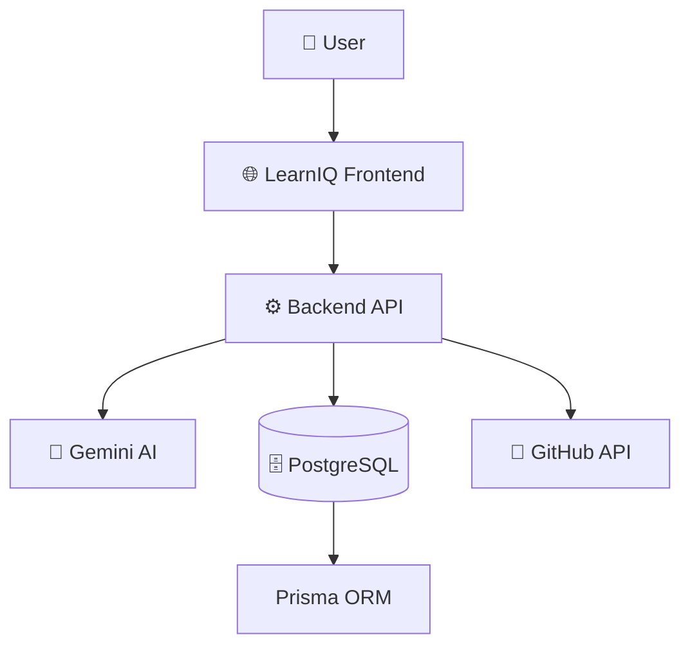

<div align="center">

# 🧠 LearnIQ

### AI-Powered Learning & Interview Intelligence Platform

<p>
  <strong>Learn smarter. Understand deeper. Prepare confidently.</strong>
</p>

<p>
  <a href="https://learniq-abhi.vercel.app/">
    
  </a>
  <a href="https://github.com/pranjaldubey009/LearnIQ">
    
  </a>
</p>

<p>
  
  
  
  
  
</p>

</div>

---

## ✦ Overview

**LearnIQ** is an AI-powered learning and interview preparation platform built to help developers and students learn more efficiently, explore their code, strengthen technical knowledge, and prepare for career opportunities.

By combining AI capabilities, developer-focused integrations, and a modern web experience, LearnIQ aims to transform the way learners approach technical preparation and skill development.

> A smarter approach to learning, powered by AI.

---

## ✨ Core Features

<table>
<tr>
<td width="50%">

### 🤖 AI-Powered Intelligence
Leverage AI-powered capabilities to support learning, understanding, and technical preparation.

</td>
<td width="50%">

### 💼 Interview Preparation
Explore tools designed to help improve technical readiness and interview confidence.

</td>
</tr>

<tr>
<td width="50%">

### 🐙 GitHub Integration
Connect developer workflows with GitHub-powered functionality and repository insights.

</td>
<td width="50%">

### 🎯 Learning Experience
A focused platform designed around skill development and structured learning.

</td>
</tr>

<tr>
<td width="50%">

### ⚡ Modern Interface
Clean, responsive, and intuitive user experience.

</td>
<td width="50%">

### 🌐 Web Platform
Access the platform through a modern web-based interface.

</td>
</tr>
</table>

---

## 🖥️ Preview

<div align="center">

### LearnIQ — Live Platform

[**Open Live Demo →**](https://learniq-abhi.vercel.app/)

</div>

> Screenshots will be added here as the project UI evolves.

---

## 🏗️ System Architecture

LearnIQ is built using a modular architecture that connects the frontend, backend services, AI integrations, database, and external APIs.



---

## 🧰 Technology Stack

| Layer | Technologies |
|---|---|
| Frontend | React, TypeScript |
| Runtime | Bun |
| Monorepo | Turborepo |
| Backend | Bun-based backend services |
| Database | PostgreSQL |
| ORM | Prisma |
| AI | Google Gemini |
| External Integration | GitHub API |
| Deployment | Vercel |

---

## 📁 Project Structure

```text
LearnIQ/
│
├── apps/
│   ├── web/              # Frontend application
│   └── server/            # Backend application
│
├── packages/              # Shared packages and configurations
│
├── prisma/                # Database schema and ORM configuration
│
├── docs/                  # Documentation and assets
│
├── package.json
├── turbo.json
└── README.md
```

> Directory names may differ depending on the current repository structure.

---

## ⚙️ Getting Started

Follow these steps to run LearnIQ locally.

### 1. Prerequisites

Ensure you have the following installed:

- [Bun](https://bun.sh/)
- Git
- PostgreSQL
- Node.js (if required by dependencies)

---

### 2. Clone the Repository

```bash
git clone https://github.com/pranjaldubey009/LearnIQ.git
```

```bash
cd LearnIQ
```

---

### 3. Install Dependencies

```bash
bun install
```

---

### 4. Configure Environment Variables

Create the appropriate `.env` file for your backend configuration.

```env
DATABASE_URL=your_postgresql_connection_string
GEMINI_API_KEY=your_gemini_api_key
GITHUB_TOKEN=your_github_token
```

| Variable | Description |
|---|---|
| `DATABASE_URL` | PostgreSQL database connection |
| `GEMINI_API_KEY` | Google Gemini API key |
| `GITHUB_TOKEN` | GitHub API access token (optional, depending on features) |

> ⚠️ Never expose API keys or commit environment files to GitHub.

---

### 5. Run the Development Server

From the project root:

```bash
bun run dev
```

---

## 🌍 Deployment

The frontend is deployed on Vercel.

| Component | Platform |
|---|---|
| Frontend | Vercel |
| Backend | Deployment configuration in progress |
| Database | PostgreSQL |

### Live Application

🔗 https://learniq-abhi.vercel.app/

---

## 🗺️ Roadmap

- [x] Initial platform development
- [x] Frontend deployment
- [x] AI integration foundation
- [x] GitHub integration foundation
- [ ] Complete backend deployment
- [ ] Expand AI-powered learning capabilities
- [ ] Improve interview preparation workflows
- [ ] Add enhanced personalized learning
- [ ] Optimize mobile experience
- [ ] Improve analytics and insights
- [ ] Expand feature ecosystem

---

## 🔐 Security

- Environment variables are used for sensitive configuration.
- API keys should never be committed to the repository.
- Production credentials should be configured securely through deployment environment settings.

---

## 🎯 Project Goals

LearnIQ aims to:

- Make technical learning more interactive.
- Improve interview preparation workflows.
- Integrate AI into developer learning experiences.
- Build a practical platform combining modern web development and AI.
- Explore the potential of AI-driven education technology.

---

## 🤝 Contributing

Contributions, suggestions, ideas, and feedback are welcome.

1. Fork the repository.
2. Create a feature branch.
3. Make your changes.
4. Commit your changes.
5. Open a Pull Request.

---

## 💡 Inspiration & Credits

LearnIQ is an independent project inspired by ideas and approaches found in AI-powered educational and developer tools.

It is being developed and iterated upon with the goal of creating a more useful learning experience.

---

## 👨‍💻 Author

<div align="center">

### Abhiman Dubey

**Developer | AI & Web Development Enthusiast**

<a href="https://github.com/pranjaldubey009">
GitHub Profile
</a>

</div>

---

## 📄 License

This project is licensed under the MIT License.

See the `LICENSE` file for more information.

---

<div align="center">

### 🧠 LearnIQ

**Learn smarter. Build better. Grow faster.**

<sub>Made with curiosity, code, and AI.</sub>

</div>

